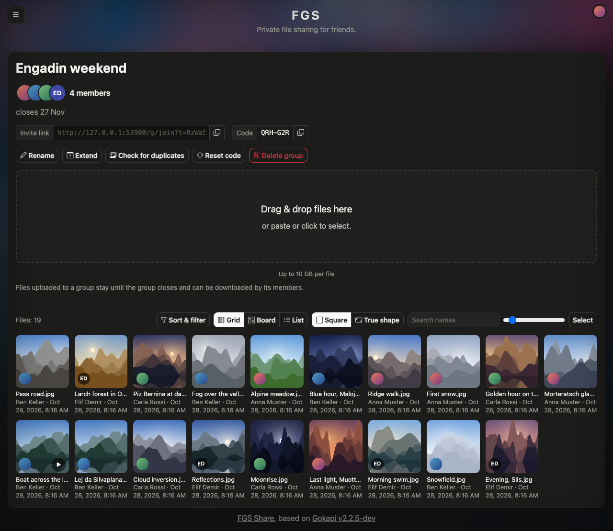
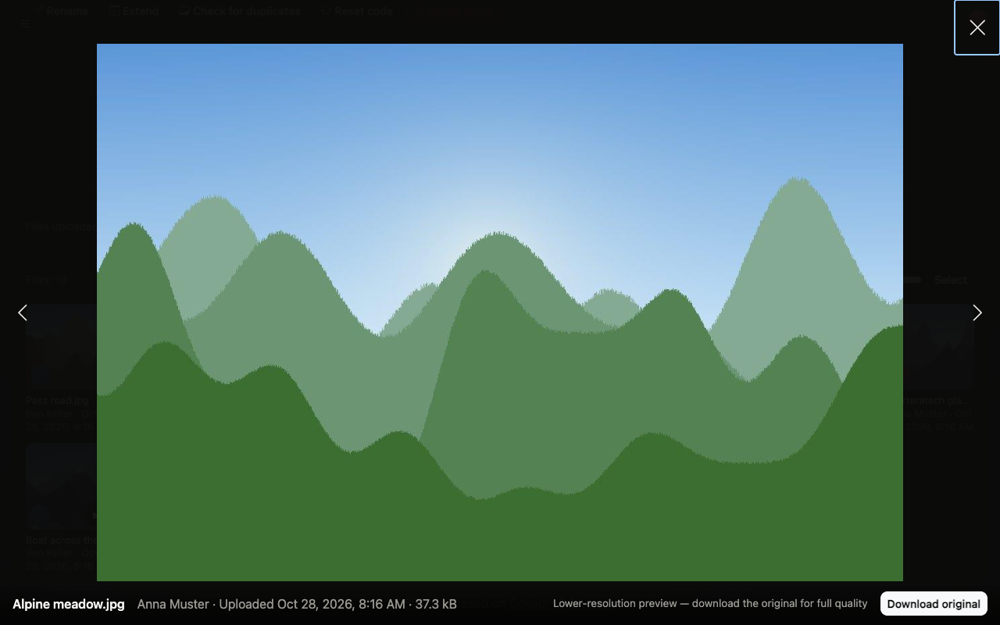
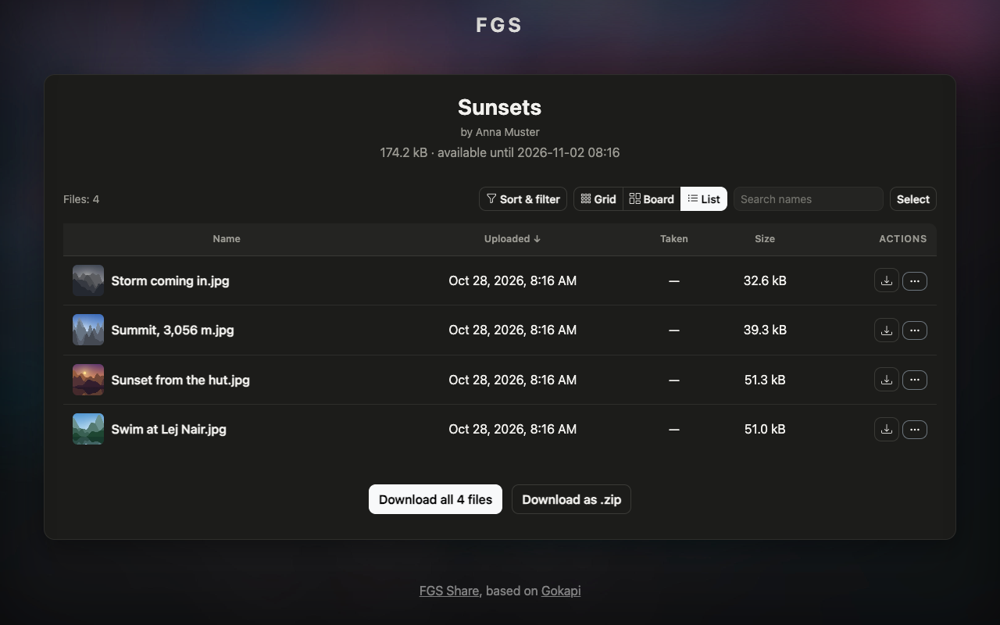
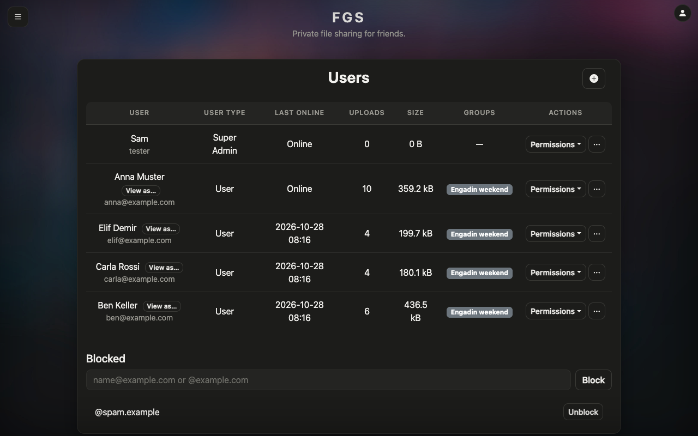
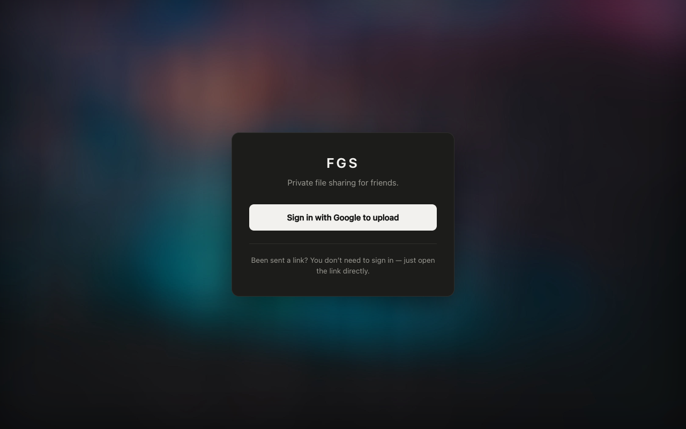
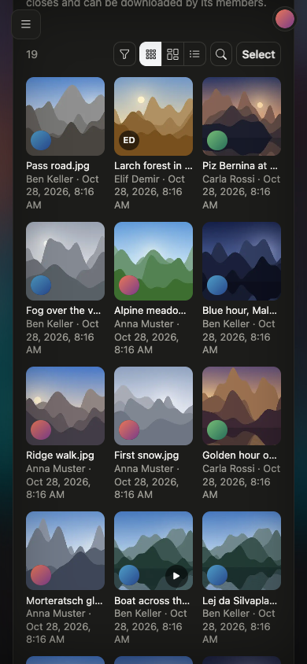
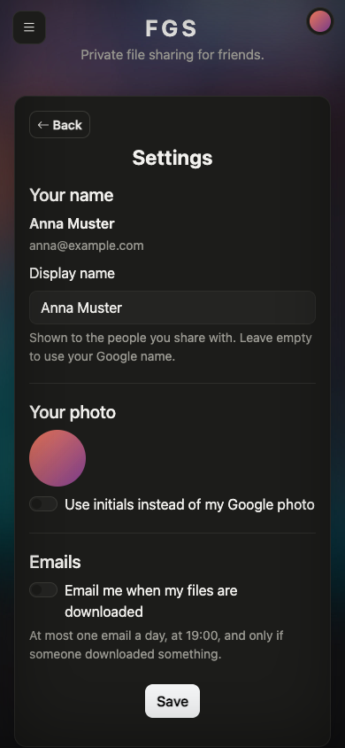

# FGS Share

A self-hosted photo and file share for friends and family. Groups collect everyone's photos from a
trip in one place, and anyone with a link can download without an account.

FGS Share is a fork of [Gokapi](https://github.com/Forceu/Gokapi) by Marc Ole Bulling and runs
[share.franco.international](https://share.franco.international). It keeps everything Gokapi does
(expiring links, file requests, collections, encryption, S3, the API) and adds the parts a shared
photo album needs: previews, groups, people, and quiet notifications.

<p align="center">
  
</p>

> **This is a personal project.** It is published because it is free software and its users are
> entitled to the source (AGPL-3.0). It has no releases and no Docker Hub image. Build it yourself
> (see [Running it](#running-it)). For plain Gokapi, use [upstream](https://github.com/Forceu/Gokapi).

## Screenshots

| | |
|---|---|
|  |  |
| The viewer: swipe or arrow through a group, download the original. | A collection, as anyone with the link sees it, no account needed. |
|  |  |
| Users: names, uploads and groups per person, View as…, and the blocklist. | The landing page, from the branding in `deploy/custom/`. |

<p align="center">
  
  &nbsp;
  
</p>

Every person, photo and email address in these screenshots is made up. The photos are drawn by
[`build/readme/make_photos.py`](build/readme/make_photos.py). See [Regenerating the screenshots](#regenerating-the-screenshots).

## What FGS Share adds

**Previews and one file list**
- A preview worker turns photos and videos into thumbnails, larger views and video posters with
  `vips` and `ffmpeg`, hardened against untrusted input. It records capture time, dimensions, average
  colour and a perceptual hash. Viewing never counts as a download.
- One file-list component everywhere (Files, Upload, Collections, File requests, groups, public
  collection pages): Grid, Board (in shooting order) and List views, a full-screen viewer, a "⋯" menu
  with every action, and undo without a page reload.
- Lists load in batches of 100. Sort, filter (person, type, "Hide what I've downloaded"), search and
  "Select all" run on the server over the whole set, so they cover files not loaded yet.

**Groups**
- Create a group, share an invite link or code, and everyone uploads into the same board.
- Creator, member and admin roles; rename, extend, reset the code, remove members, leave, delete.
- Exact duplicates are refused before upload. Near-copies are flagged by perceptual hash, with
  Compare, Keep both and Remove. Ticks show what you have already downloaded.
- "Upload to" a group from the Upload page, "Add to group…" from any list, and "Turn into a group"
  for an existing collection.

**iPhone**
- "Save to Photos" in measured batches, with large videos sent to a zip instead, and a help sheet.
  Download all works through a zip or Save to Photos.

**People**
- Display names everywhere instead of email prefixes, and Google profile photos fetched at sign-in.
- A Settings page: name, "Use initials" instead of the photo, and an optional daily email digest.
- A blocklist of exact emails or whole `@domains`, checked at Google sign-in before an account
  exists, at password login, on API keys and on every session.
- Admin-only **View as…**: see the site as another user, read-only, with every start and end logged.

**Activity and notifications**
- An `Activity` table and an admin-only `GET /api/activity` feed: uploads, downloads, groups,
  first and blocked sign-ins, disk and preview warnings, View as.
- A notifier ([`deploy/notifier/`](deploy/notifier/)) that reads the feed and emails the admin
  only when something matters. New people, new groups and warnings are sent at once; everything else
  is summarised after an hour of quiet. Friends can opt into one email a day, at 19:00, when
  someone downloaded their files.

**Deployment and hardening**
- [`deploy/`](deploy/) holds the compose file as it runs (`no-new-privileges`, all capabilities
  dropped, memory, CPU and process limits, loopback-only port), the branding, and the notifier's
  launchd agent.
- Group and collection endpoints accept only `POST` with JSON. The join form checks the request's
  origin. `/custom/` serves only the named branding files.

The schema stays at upstream's version 17. New tables are created with `IF NOT EXISTS`, so an
older image still runs on the same database.

The full guide is in [`docs/fgs-share.rst`](docs/fgs-share.rst).

## Inherited from Gokapi

- Expiring shares, removed after a number of downloads or days
- Users with roles and fine-grained permissions; only registered users upload
- File requests: a link that lets others upload to you
- Collections: several files behind one link, optionally password protected
- Deduplication, server-side and end-to-end encryption
- AWS S3 and S3-compatible storage
- OpenID Connect sign-in (Google, Authelia, Keycloak, Entra…)
- A REST API and a CLI client
- Custom CSS and JavaScript without recompiling

## Running it

There is no published image. Build one from this repository:

```bash
git clone https://github.com/franco-g-s/fgs-share.git
cd fgs-share
docker build -t fgs-share .
docker run -d --name fgs-share \
  -v fgs-data:/app/data -v fgs-config:/app/config \
  -p 127.0.0.1:53842:53842 -e TZ=Europe/Zurich \
  fgs-share
```

Then open `http://localhost:53842/setup` and follow the setup wizard. The image includes `vips` and
`ffmpeg` for previews. A native build needs `vips`, `vipsheader`, `ffmpeg` and `ffprobe` on the
`PATH`; without them files still upload and download, but get no previews.

For the setup this fork is built around (Google sign-in, Cloudflare Tunnel, the hardened compose file
and branding), see [`deploy/README.md`](deploy/README.md) and the [setup guide](docs/setup.rst).

**Requirements:** upstream's minimum is 1 CPU core and 256 MB RAM. Preview generation needs more:
the live instance runs with a 1 GB, 1.5-CPU limit. Previews are made only for files on local
storage that are not end-to-end encrypted.

## Documentation

The guide is in [`docs/`](docs/), as reStructuredText that renders on GitHub:
[setup](docs/setup.rst), [usage](docs/usage.rst), [what FGS Share adds](docs/fgs-share.rst),
[updating](docs/update.rst), [advanced](docs/advanced.rst),
[troubleshooting](docs/troubleshooting.rst) and the [changelog](docs/changelog.rst). To build it
as HTML:

```bash
pip install -r docs/requirements.txt
make -C docs html
```

The design and the implementation plans for each part are in [`docs/design/`](docs/design/) and
[`docs/superpowers/plans/`](docs/superpowers/plans/). Each plan ends with the decisions taken
during the work and its deploy record.

## Development

There is no Go toolchain on the server this runs on, so tests run in Docker, in the same Alpine
toolchain the Dockerfile builds with:

```bash
build/dev/gotest.sh ./...                  # go generate + go test -tags=test,awsmock
```

Without `-tags=test`, `go test` reports "no test files" and exits successfully, which looks like a pass.

The end-to-end scripts in [`build/e2e/`](build/e2e/) drive a throwaway container on
`127.0.0.1:53900` (`setup_local.py` first, then `groups_e2e.py`, `collections_e2e.py`,
`part3_e2e.py`, `part4_e2e.py`). The notifier has its own tests:
`cd deploy/notifier && python3 -m unittest`.

### Regenerating the screenshots

1. Build the image, run it on `127.0.0.1:53900` with `-e GOKAPI_PORT=53900 -e GOKAPI_E2E_SEED=1`
   and `deploy/custom` mounted at `/app/custom`, and run `build/e2e/setup_local.py`.
2. `python3 build/readme/make_photos.py work/png`, then convert to JPEG with `vips copy` inside the
   image. Add one MP4 made with `ffmpeg` from one of the photos, named `Boat across the lake.mp4`.
3. `python3 build/readme/seed_readme.py work/jpg` creates the people, the group and the collection.
4. Take the screenshots at 1280×800 (the group page at 1280×1110) and 390×844 into `docs/screenshots/`.

### Staying in sync with upstream

`main` started from Gokapi's `master` (v2.2.5-dev, July 2026). To bring in upstream changes:

```bash
git remote add upstream https://github.com/Forceu/Gokapi.git
git fetch upstream
git merge upstream/master
```

## Security

Report vulnerabilities privately through
[GitHub's private reporting](https://github.com/franco-g-s/fgs-share/security/advisories/new),
not in a public issue. See [SECURITY.md](SECURITY.md). If the problem is in upstream Gokapi code
rather than this fork's changes, report it to [upstream](https://github.com/Forceu/Gokapi/security) as well.

## License and credits

AGPL-3.0, as upstream. See [LICENSE.md](LICENSE.md). Running a modified copy as a public service
means offering its users the source; the site's footer links here for that reason.

Gokapi is written by [Marc Ole Bulling](https://github.com/Forceu) and its
[contributors](https://github.com/Forceu/Gokapi/graphs/contributors). If you find it useful, consider
[supporting the original project](https://liberapay.com/MBulling/donate).
